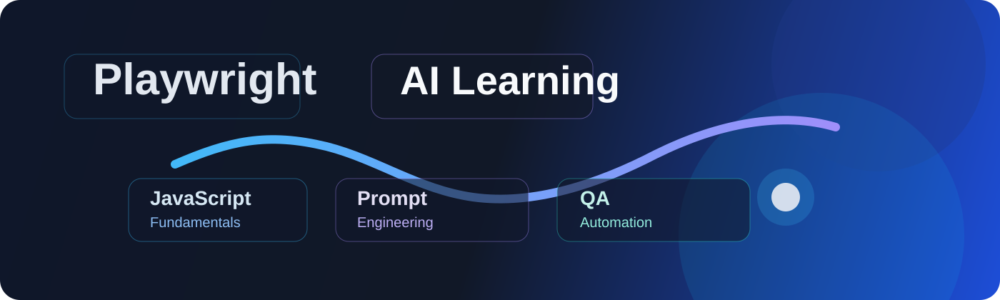
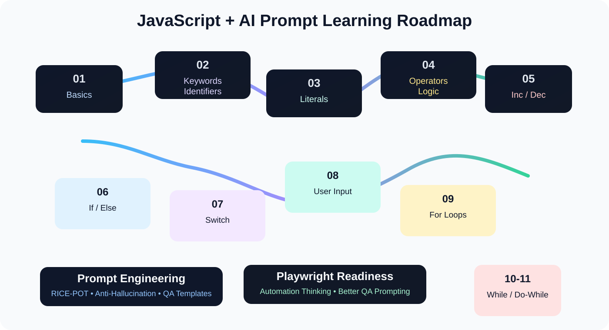

# Playwright AI Learning

<p align="center">
  
</p>

A hands-on learning repository for JavaScript fundamentals, prompt engineering, and QA automation thinking. This project is designed for learners who want to build a stronger foundation in coding logic, structured AI prompting, and practical problem solving for Playwright-based testing workflows.

## Overview

This repository combines:

- JavaScript practice from beginner to intermediate level
- Structured prompt engineering patterns for AI assistants
- Anti-hallucination techniques for better QA and automation output
- Real-world thinking around testing, logic, and validation

The goal is not to create a production app, but to help build real understanding. Learners work through code examples, logic exercises, and reusable prompt techniques before moving into automation and QA work.

## Why this repository exists

The project supports learning in the following areas:

- JavaScript basics and syntax
- Variables, keywords, identifiers, and comments
- Literals and data types
- Operators and decision logic
- If/else, switch, and loop structures
- Increment/decrement and nullish coalescing
- Structured RICE-POT style prompting for AI tools
- Anti-hallucination habits in coding and testing
- Better QA problem-solving and Playwright readiness

## Learning roadmap

<p align="center">
  
</p>

## Project structure

```text
Playwright-AI-Learning-1/
├── 00_Chapter_Prompt_engineering/
│   ├── 00_RicePot_fullform.md
│   ├── 01_RicePot_prompt.md
│   ├── 02_RicepPot_Problem_statement.md
│   ├── 04_AntiHallucination.md
│   └── 05_RicePot_Generic_Qa_Template.md
├── 01_Chapter_JS_Learning/
│   ├── 01_Chapter_JS_Basics/
│   │   ├── 001_HelloWorld.js
│   │   └── 002_Math.js
│   ├── 02_Chapter_JS_keyword_identifiers/
│   │   ├── 003_JS_Engine.js
│   │   ├── 004_JS_Let.js
│   │   ├── 005_JS_Keyword.js
│   │   ├── 006_JS_Keyword_rules.js
│   │   ├── 007_Js_Keyword_rules2.js
│   │   ├── 008_JS_comments.js
│   │   └── 009_IQ.js
│   ├── 03_Chapter_JS_Literals/
│   │   ├── 010_literals.js
│   │   ├── 011_Number.js
│   │   ├── 012_Null_undefined.js
│   │   ├── 013_Null.js
│   │   ├── 014_Literals.js
│   │   ├── 015_Number.js
│   │   ├── 016_Number_part2.js
│   │   ├── 017_Special.js
│   │   └── 018_Undefined.js
│   ├── 04_Chapter_JS_Operators/
│   │   ├── 019_Operators.js
│   │   ├── 020_Assignment_operator.js
│   │   ├── 021_Arthimetic_operator.js
│   │   ├── 022_comaprision_operator.js
│   │   ├── 023_Logical_Operator.js
│   │   ├── 024_Confusing_Comaparitor_operator.js
│   │   ├── 025_question.js
│   │   ├── 026_String_concatination.js
│   │   ├── 027_Ternary_operator.js
│   │   ├── 028_Ternary_oper_number.js
│   │   ├── 029_Ternary_operator_string.js
│   │   ├── 030_Ternary_ope_boolean.js
│   │   ├── 031_Template_Literal.js
│   │   ├── 032_Template_Literal_part2.js
│   │   ├── 033_Nested_ternary.js
│   │   ├── 034_Nested_ternary_part2.js
│   │   ├── 035_nested_ternary_ope_part3.js
│   │   └── 036_typeOf.js
│   ├── 05_Chapter_JS_increment_decre_op/
│   │   ├── 037_Post_Increment_operator.js
│   │   ├── 038_Pre_increment_operator.js
│   │   ├── 039_Practice_exercise.js
│   │   ├── 040_practice_ex2.js
│   │   ├── 041_Practice_ex3.js
│   │   ├── 042_pre_decrement.js
│   │   ├── 043_post_decrement.js
│   │   ├── 044_task.js
│   │   └── 045_nullish_coalescing_operator.js
│   ├── 06_Chapter_If_else_statement_condition/
│   │   ├── 046_If.js
│   │   ├── 047_if_else_nested.js
│   │   ├── 048_Ternaryoperator_vs_ifelse.js
│   │   └── 049_Multiple_ifelse.js
│   ├── 07_Chapter_Switch/
│   │   ├── 050_Switch.js
│   │   ├── 051_Switch_without_break_statement.js
│   │   ├── 052_Switch_IQ.js
│   │   ├── 053_Switch_API_code.js
│   │   ├── 054_Switch_Group_Statements.js
│   │   ├── 055_Switch_IQ2.js
│   │   ├── 056_Switch_IQ3.js
│   │   ├── 057_Switch_IQ4.js
│   │   ├── 058_Switch_IQ5.js
│   ├── 08_Chapter_UserInput/
│   │   ├── 059_UI.js
│   │   ├── 060_Node_UI.js
│   │   ├── 061_Prompt_Sync.js
│   │   └── 062_FS_readfile.js
│   ├── 09_Chapter_Loops/
│   │   ├── 063_Loops.js
│   │   ├── 064_For_loop.js
│   │   ├── 065_For_loop_ex2.js
│   │   ├── 066_For_loop_Decrement.js
│   │   ├── 067_For_loop_lateralscenario.js
│   │   ├── 068_For_loop_without_condition.js
│   │   └── 069_For_loop_with_ifelse.js
│   ├── 10_Chapter_While_Loop/
│   │   ├── 070_While_Loop.js
│   │   ├── 071_While_Loops_Ex2.js
│   │   ├── 072_While_Loop_Ex3.js
│   │   └── 073_While_Loop_With_ifelse.js
│   └── 11_Chapter_Loops_DoWhile/
│       ├── 074_DoWhile.js
│       ├── 075_DoWhile_IQ.js
│       ├── 076_Nested_For_Loop.js
│       └── 077_IQ.js
├── images/
│   ├── playwright-ai-learning-banner.svg
│   └── js-learning-roadmap.svg
├── README.md
└── .git/
```

## Core learning modules

### 1. Prompt engineering

This part focuses on structured prompt design using the RICE-POT framework and other AI-assisted QA thinking patterns.

Included materials:

- `RICE-POT` framework for writing robust prompts
- problem statement design for QA and automation tasks
- anti-hallucination guidance
- reusable QA prompt templates

Key ideas:

- Role: define the persona and expertise
- Instructions: give clear and specific rules
- Context: include the actual environment and constraints
- Example: provide a sample structure or expected output
- Parameters: define versions, boundaries, and limitations
- Output: define the exact response format
- Tone: keep communication precise and professional

### 2. JavaScript basics

This section introduces the foundations of JavaScript:

- `console.log()` and code execution
- arithmetic and expressions
- JavaScript engine and runtime behavior
- `let`, `var`, and `const`
- keywords and identifiers
- comments and code clarity
- literals and values

Example:

```js
let age = 9;
var a = 90;
const c = 23;
console.log(age, a, c);
```

### 3. Literals and data types

The project covers values written directly in code, including:

- number literals
- string literals
- boolean literals
- `null` and `undefined`
- typeof checks and special values

Example:

```js
let num = 42;
let text = "Hello";
let flag = true;
let emptyValue = null;
let notAssigned;
```

### 4. Operators and decision logic

Topics include:

- arithmetic operators
- assignment operators
- comparison and logical operators
- ternary operators
- template literals
- nested conditionals
- strict vs loose comparison

Example:

```js
console.log(10 > 5);        // true
console.log("10" === 10);   // false
console.log(true && false);  // false
console.log(true || false);  // true
```

### 5. Conditions, switches, and user input

This section adds real logic flow to JavaScript fundamentals:

- `if` / `else` statements
- nested conditions
- switch statements
- user input handling
- reading input and files from Node.js

### 6. Loops and iteration

The project also covers the major loop patterns:

- `for` loops
- `while` loops
- `do...while` loops
- loop exercises with conditions
- nested patterns and practical scenarios

Example:

```js
for (let i = 1; i <= 5; i++) {
  console.log(i);
}
```

### 7. Advanced learning mindset

Later chapters move toward habits needed for QA automation and AI-assisted development:

- verifying assumptions before coding
- avoiding hallucinated APIs or methods
- writing clear, testable logic
- thinking about edge cases and failure states
- preparing for Playwright project automation work

## Key learning outcomes

By the end of this project, a learner should be able to:

- write and understand JavaScript syntax more confidently
- reason through logic and control flow
- work with data types and operators safely
- build better prompts for AI tools and QA tasks
- reduce hallucinated output by checking evidence and constraints
- prepare for Playwright automation, test design, and browser-based QA work

## How to run the JavaScript files

Use Node.js from the terminal:

```bash
node 01_Chapter_JS_Learning/01_Chapter_JS_Basics/001_HelloWorld.js
```

You can run any other `.js` file in the same way by pointing Node to the script file.

## Suggested learning path

1. Start with JavaScript basics and arithmetic.
2. Move into keywords, identifiers, and comments.
3. Practice literals and data types.
4. Work through operators, conditional statements, and ternary logic.
5. Study loops and user input patterns.
6. Apply the prompt-engineering ideas to AI-assisted QA and automation work.

## Why this project matters

This repository helps learners build a strong base for:

- understanding code structure and logic flow
- writing cleaner JavaScript
- prompting AI tools more effectively
- validating AI-generated output critically
- preparing for Playwright, test automation, and modern QA workflows

## Summary

This is a beginner-friendly learning workspace that blends JavaScript fundamentals with practical prompt-engineering concepts. It is useful for learners who want to improve both coding logic and AI-assisted problem-solving, with a clear path toward QA automation and Playwright-based testing.

<p align="center">
  
</p>
